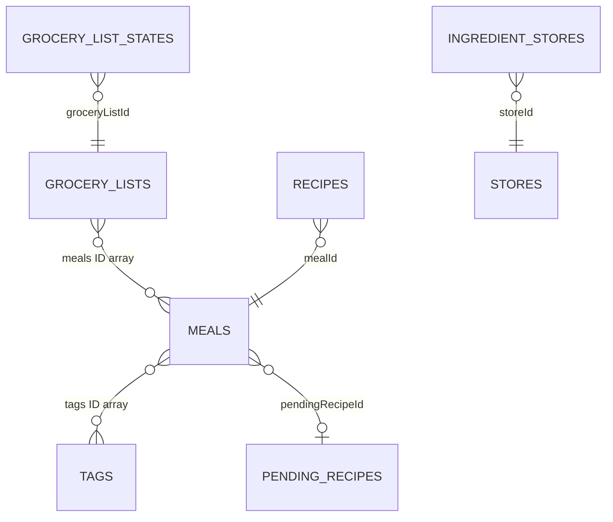

# Browser data model

The persistent Dexie database is named `groceriesHelper`. Temporary import comparisons instantiate the same subclass with a UUID suffix. All definitions and index strings below come from [apps/frontend/src/db/db.ts](../../apps/frontend/src/db/db.ts); these are application relationships rather than enforced foreign keys.

## Tables, keys, and indexes

`++id` is an auto-increment numeric primary key, `&id` a unique primary key, `*tags` a multi-entry index, `&color` a unique secondary index, and `&[ingredientName+storeId]` a unique compound index. A listed ordinary index is not a uniqueness constraint. The schema declares 11 tables. Source: [db.ts](../../apps/frontend/src/db/db.ts).

| Table | Exact Dexie schema | Stored fields beyond the key / purpose |
| --- | --- | --- |
| `meals` | `++id, name, createdAt, updatedAt, *tags, pendingRecipeId` | Name, embedded ingredients, optional legacy recipe text, tag IDs, created/updated dates, optional pending recipe ID and image descriptors. |
| `groceryLists` | `++id, name, createdAt` | Name, meal ID array, optional embedded custom ingredients, created date. Meal IDs are not separately indexed. |
| `groceryListStates` | `++id, groceryListId` | Grocery list ID and checked ingredient-name array. The list ID index is not unique. |
| `recipes` | `++id, mealId` | Meal ID, images (`File` or URL string), URL, notes. Meal ID is not unique. |
| `tags` | `++id, name` | Descriptive tag name; names are not unique in the schema. |
| `customIngredients` | `++id, name, usageCount` | Ingredient name and optional usage count for suggestions. Actual list quantities are embedded in groceryLists. |
| `pendingRecipes` | `&id, createdAt` | Client UUID string, optional text, source URL, date and optional shared image descriptors. |
| `settings` | `&id` | String setting key/value. |
| `stores` | `++id, name, &color` | Store name and optional uniquely indexed color. Store names are not unique. |
| `ingredientStores` | `++id, &[ingredientName+storeId], storeId` | Ingredient name/store ID mapping. Multiple stores per ingredient are allowed, duplicate pairs are not. No standalone ingredientName index. |
| `syncs` | `++id, type, createdAt` | Direction (`to`/`from`), filename, uploadType (`manual`), created date, optional URL, automatic flag, lastSyncedAt, expiresAt and alias. Filename and direction are not unique. |

`Ingredient` holds a name and optional quantity. Forms trim/lowercase names and default missing quantities to 1 on save; the schema validates provided quantities as at least 1. Database interfaces and shared wire types are distinct: model tag strings are resolved to numeric tag IDs before storing a meal. Sources: [ingredient schema](../../apps/frontend/src/types/ingredients.ts), [meal form schema](../../apps/frontend/src/types/meals.ts), [Meals.tsx](../../apps/frontend/src/pages/Meals.tsx), [GroceryList.tsx](../../apps/frontend/src/pages/GroceryList.tsx), [shared meal contract](../../apps/frontend/src/shareable/meals.ts).

## Relationships and lifecycles

The diagram shows reference fields, not database-enforced existence or deletion constraints. In particular recipes and groceryListStates can contain multiple rows for the same referenced ID; UI queries use `.first()`. Ingredient-store links match normalized ingredient names embedded in meals/lists rather than IDs in a canonical ingredients table. Sources: [db.ts](../../apps/frontend/src/db/db.ts), [recipe route](../../apps/frontend/src/routes/recipe.$mealId.tsx), [GroceryListContainer.tsx](../../apps/frontend/src/components/GroceryListContainer.tsx), [ManageStores.tsx](../../apps/frontend/src/pages/ManageStores.tsx).

On generated meal save, automatic recipe creation writes a recipe row with the new meal ID and optionally uses its single image as a thumbnail. Deferred creation writes a pendingRecipes UUID and stores its ID on the meal. Saving the eventual recipe removes the pending row and clears the meal reference. A meal also retains generated text in its optional `recipe` field; the attached editor uses the separate recipes table. Sources: [Meals.tsx](../../apps/frontend/src/pages/Meals.tsx), [recipe.$mealId.tsx](../../apps/frontend/src/routes/recipe.$mealId.tsx).

Meal image descriptors support a URL, a File, or a `recipeImage` containing recipeId/imageIndex and optional isThumbnail. Recipe images are File/string arrays; generated image descriptors additionally support Blob/base64 and are converted before attachment. The recipe editor uses `Number(mealId)` for recipe-image reference comparisons/creation in several places, whereas generated meal creation stores the actual inserted recipe ID. Those IDs need not coincide; this is a source inconsistency, not a reliable relationship guarantee. Sources: [db.ts](../../apps/frontend/src/db/db.ts), [shareable/meals.ts](../../apps/frontend/src/shareable/meals.ts), [images.ts](../../apps/frontend/src/util/images.ts), [Meals.tsx](../../apps/frontend/src/pages/Meals.tsx), [recipe route](../../apps/frontend/src/routes/recipe.$mealId.tsx).

Deleting a meal only deletes its meals row; it does not cascade through recipes, lists, pendingRecipes, tags, or image references. List deletion similarly only removes its list row. StoreManagementDialog deletes the store and its associations in one transaction. Custom-ingredient usage counts are maintained by list edits and can be rebuilt from current lists in Settings. Sources: [Meals.tsx](../../apps/frontend/src/pages/Meals.tsx), [GroceryList.tsx](../../apps/frontend/src/pages/GroceryList.tsx), [StoreManagementDialog.tsx](../../apps/frontend/src/components/StoreManagementDialog.tsx), [Settings.tsx](../../apps/frontend/src/pages/Settings.tsx).

Known setting names are `lastEditedGroceryListId`, `youtubeApiPass`, and `pwaUpdateNotificationsEnabled`. Sync helpers read the first row by direction even though the schema allows several. `uploadType: manual` is persisted metadata; API storage selection is the separate `R2` wire discriminator. Sources: [settings.ts](../../apps/frontend/src/util/db/settings.ts), [Settings.tsx](../../apps/frontend/src/pages/Settings.tsx), [sync.ts](../../apps/frontend/src/util/sync.ts), [sync-from.ts](../../apps/frontend/src/util/sync-from.ts), [file-upload contract](../../apps/frontend/src/shareable/file-upload.ts).

## Schema versions and date migration

The constructor declares versions 12 and 14 with identical table/index strings; it contains no versions 1-11 or 13. Version 14 upgrades meal createdAt/updatedAt, list createdAt, pending-recipe createdAt, and sync createdAt/lastSyncedAt/expiresAt to ISO strings. This code does not prove compatibility with every older historical database shape. Source: [db.ts](../../apps/frontend/src/db/db.ts).

The singleton installs create/update hooks that write those dates as ISO strings and read hooks that return Date objects, despite interfaces typing them as Date. Settings exposes a forced conversion transaction over the same four tables. Temporary DB instances do not install these singleton hooks. Invalid dates may fail `toISOString`; the forced helper leaves unparseable strings unchanged, unlike the version-upgrade helper. Sources: [date-converter.ts](../../apps/frontend/src/db/date-converter.ts), [db.ts](../../apps/frontend/src/db/db.ts), [migration.ts](../../apps/frontend/src/util/db/migration.ts), [Settings.tsx](../../apps/frontend/src/pages/Settings.tsx), [temporary import](../../apps/frontend/src/util/db/import.ts).

## Export, import, and snapshot comparisons

`INCLUDE_TABLES` selects meals, groceryLists, groceryListStates, recipes, tags, customIngredients, pendingRecipes, stores, and ingredientStores. Export uses `dexie-export-import` with that filter; settings (including the API pass) and syncs (including signed URLs) are excluded. Local export downloads a JSON-named file through an object URL. Sources: [db.ts](../../apps/frontend/src/db/db.ts), [export.ts](../../apps/frontend/src/util/db/export.ts), [home route](../../apps/frontend/src/routes/index.lazy.tsx).

`handleFileImport` clears those nine tables one at a time, then calls `importDB` with `noTransaction: true` and the same table filter. It is replacement, not merge, and does not preserve data atomically on failure: a rejected or malformed import can leave cleared/partially restored local data. Settings and syncs are not cleared by the helper. The source does not show an import round-trip test, so successful Date/File restoration should not be inferred from interfaces alone. Source: [import.ts](../../apps/frontend/src/util/db/import.ts).

Diff calculation imports into a randomly named temporary DB through `importInto`. It accepts missing tables, version/name differences and changed primary keys, clearing temporary tables before import. It compares old/new sets of meal names only, then closes/deletes the temporary DB after successful comparison. Same-name meal edits, recipe changes, list changes, IDs and other table changes do not appear in the confirmation summary. Error-path temporary DB cleanup is not protected by a `finally`. Source: [import.ts](../../apps/frontend/src/util/db/import.ts).

Home import refetches the relevant page queries after completion. Modal-confirmed sync imports only invalidate `syncFrom`; manual same-name sync follows the same narrow invalidation. AppWrapper's automatic same-name path does not import at all. These differences can matter for displayed freshness and changed records; they do not provide a complete conflict detector. Sources: [index.lazy.tsx](../../apps/frontend/src/routes/index.lazy.tsx), [DiffsModalProvider.tsx](../../apps/frontend/src/contexts/DiffsModalProvider.tsx), [SyncSettings.tsx](../../apps/frontend/src/components/SyncSettings.tsx), [App.tsx](../../apps/frontend/src/App.tsx).
