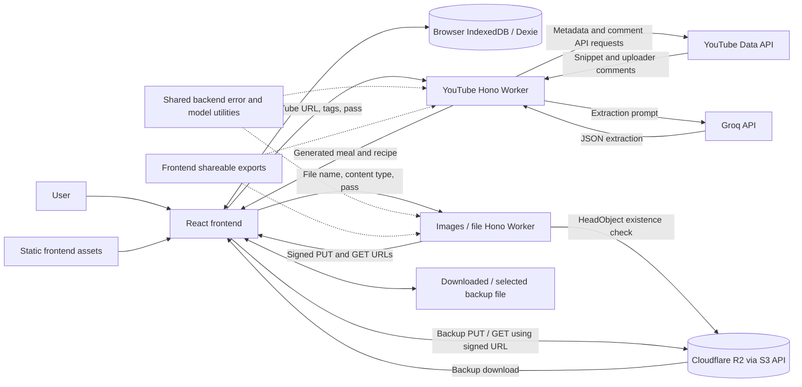

# Architecture overview

Go Groceries manages meals, attached recipes, grocery lists, and ingredient-to-store assignments in the browser. A shopping view combines meal and custom ingredients and persists checked ingredient names. Users can prefill meals from YouTube and exchange database backups through a file service. Image-based meal creation is still a placeholder. Sources: [Meals.tsx](../../apps/frontend/src/pages/Meals.tsx), [GroceryList.tsx](../../apps/frontend/src/pages/GroceryList.tsx), [GroceryListContainer.tsx](../../apps/frontend/src/components/GroceryListContainer.tsx), [ManageStores.tsx](../../apps/frontend/src/pages/ManageStores.tsx), [FromImagesMealCreation.tsx](../../apps/frontend/src/components/FromImagesMealCreation.tsx).

## Workspace layout and dependencies

The private npm root includes `apps/*` and `libraries/*` workspaces and delegates its sole script, `build`, to Turbo. The package manager declaration is npm 11.4.2. Sources: [root package.json](../../package.json), [turbo.json](../../turbo.json).

| Directory | Package name | Responsibility and dependencies |
| --- | --- | --- |
| [apps/frontend](../../apps/frontend/package.json) | `@go-groceries/frontend` | React/Vite/MUI browser application; Dexie owns persisted state. Also owns shareable worker request/response contracts. |
| [apps/go-groceries-youtube-meal-resolver](../../apps/go-groceries-youtube-meal-resolver/package.json) | `go-groceries-youtube-api` | Hono Worker that retrieves YouTube metadata/comments and invokes Groq. Depends on `@go-groceries/backend`; frontend contracts are a dev dependency. |
| [apps/go-groceries-images-meal-resolver](../../apps/go-groceries-images-meal-resolver/package.json) | `go-groceries-images-api` | Hono Worker with implemented R2 upload/retrieval signing and a stub image-generation route. Depends on backend and frontend packages. |
| [libraries/shared-backend](../../libraries/shared-backend/package.json) | `@go-groceries/backend` | Error wrapper and model interfaces/selector shared with workers. Emits JavaScript and declarations to `dist`. |

The dependency direction is unusual: workers import contracts from the frontend package rather than a standalone schema library. Frontend export subpaths are `./meals`, `./file-upload`, `./file-retrieval`, and `.` (error response). Meals and root exports expose types only. File contracts expose TypeScript source types plus emitted `build/shareable/*.js`; the images Worker imports the runtime `ALLOWED_CONTENT_TYPES` constant. Sources: [frontend exports](../../apps/frontend/package.json), [shareable contracts](../../apps/frontend/src/shareable/meals.ts), [images types.ts](../../apps/go-groceries-images-meal-resolver/src/types.ts), [YouTube types.ts](../../apps/go-groceries-youtube-meal-resolver/src/types.ts).

The backend export subpaths `./endpoints/error` and `./models` reference `dist` code/declarations. Its root source entry is empty. Runtime consumers therefore depend on emitted package artifacts, not only checked-in TypeScript. The root TypeScript alias for `@go-groceries/backend/*` names `libraries/backend/src/*`, while the actual directory is `libraries/shared-backend`; build/resolution success is not established by that alias. Sources: [backend package.json](../../libraries/shared-backend/package.json), [backend tsconfig.json](../../libraries/shared-backend/tsconfig.json), [backend entry](../../libraries/shared-backend/src/index.ts), [root tsconfig.json](../../tsconfig.json).

## Component and data flow

Solid arrows describe calls or data transfer; dotted arrows describe code dependencies. The diagram shows browser-originated backup object transfers: the file Worker signs URLs, rather than receiving the uploaded file body. Static asset uploads use a separate S3 script. Sources: [sync.ts](../../apps/frontend/src/util/sync.ts), [sync-from.ts](../../apps/frontend/src/util/sync-from.ts), [uploadFile](../../apps/frontend/src/util/file/file-upload.ts), [file Worker entry](../../apps/go-groceries-images-meal-resolver/src/index.ts), [R2 presign GET](../../apps/go-groceries-images-meal-resolver/src/file-upload/r2-presign-get.ts), [static upload script](../../apps/frontend/scripts/upload-to-s3.js).

The YouTube result first fills an editable meal form. Saving normalizes ingredient/tag names and creates either an attached recipe immediately or a UUID-keyed pending recipe that can be imported later without another YouTube call. Sources: [FromYoutubeMealCreation.tsx](../../apps/frontend/src/components/FromYoutubeMealCreation.tsx), [Meals.tsx](../../apps/frontend/src/pages/Meals.tsx), [recipe route](../../apps/frontend/src/routes/recipe.$mealId.tsx).

IndexedDB is the application's local persisted state. The Workers do not register a central meal CRUD database. Sync exports selected tables as a snapshot; import replaces local content, and the confirmation diff only compares meal names. It is not an entity-level conflict merge. Sources: [db.ts](../../apps/frontend/src/db/db.ts), [YouTube entry](../../apps/go-groceries-youtube-meal-resolver/src/index.ts), [images entry](../../apps/go-groceries-images-meal-resolver/src/index.ts), [export.ts](../../apps/frontend/src/util/db/export.ts), [import.ts](../../apps/frontend/src/util/db/import.ts).

## Boundaries and limits

Worker authorization uses a shared request-body pass, with enforcement controlled by `ENABLE_PASS`; there is no per-user ownership check in these route handlers. Both Workers use wildcard CORS. Signed R2 links grant direct object access while valid, and the frontend can share them. Sources: [YouTube handler](../../apps/go-groceries-youtube-meal-resolver/src/endpoints/generate-meal-data.ts), [file upload handler](../../apps/go-groceries-images-meal-resolver/src/endpoints/file-upload.ts), [file retrieval handler](../../apps/go-groceries-images-meal-resolver/src/endpoints/file-retrieval.ts), [CORS](../../apps/go-groceries-images-meal-resolver/src/endpoints/cors.ts), [SyncSettings.tsx](../../apps/frontend/src/components/SyncSettings.tsx).

Source establishes configured PWA support and deployment entry points. It does not establish live domains, deployed Worker versions, bucket policies/CORS, hosting infrastructure, or external model availability. Those need separate runtime/infrastructure verification. Sources: [vite.config.ts](../../apps/frontend/vite.config.ts), [YouTube wrangler.jsonc](../../apps/go-groceries-youtube-meal-resolver/wrangler.jsonc), [images wrangler.jsonc](../../apps/go-groceries-images-meal-resolver/wrangler.jsonc), [upload script](../../apps/frontend/scripts/upload-to-s3.js).
